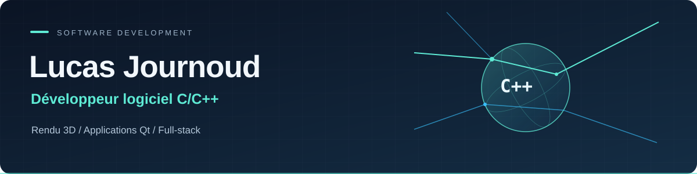
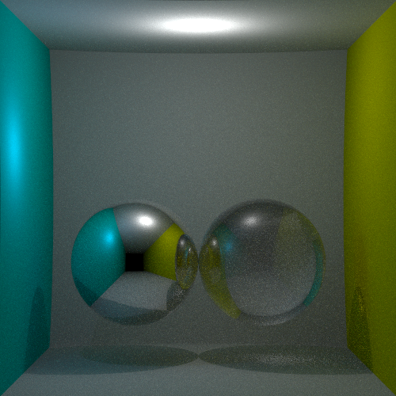
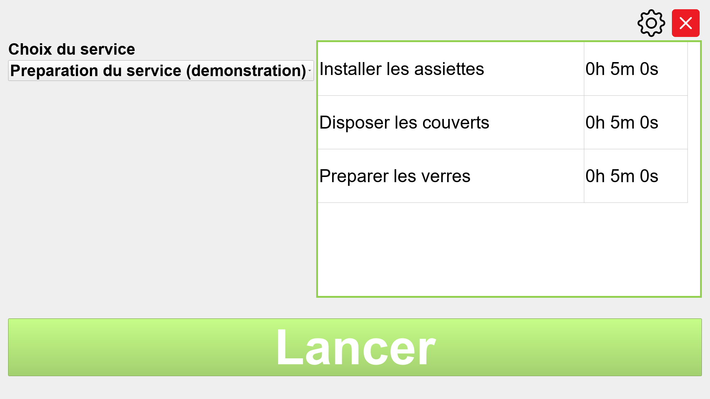
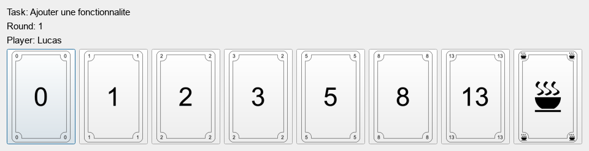
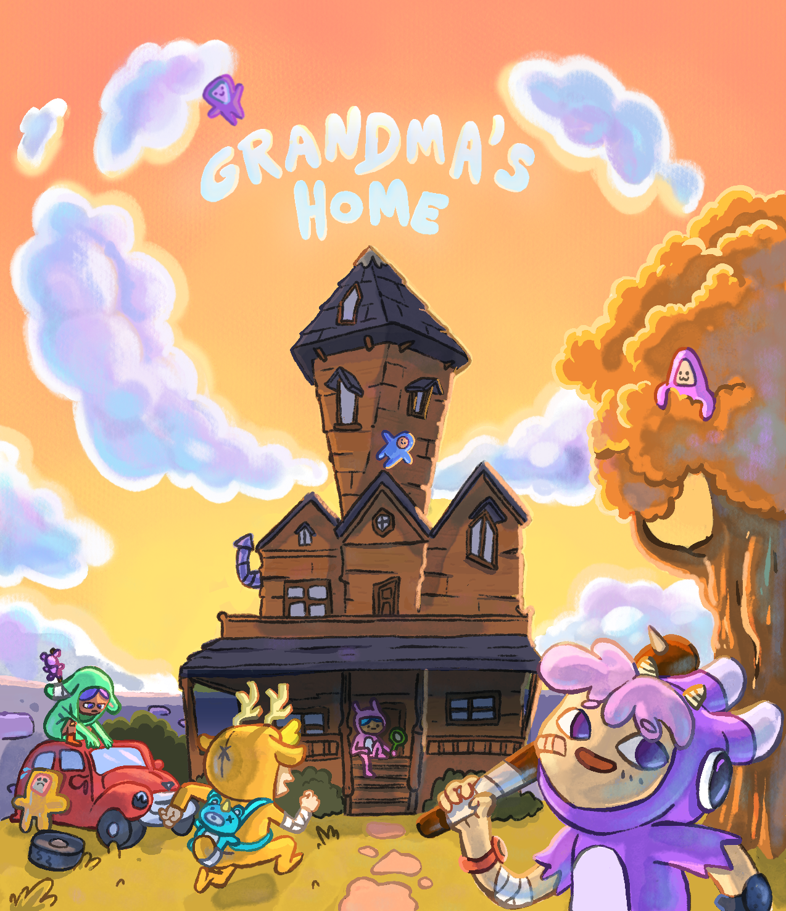

  

  
  

## Concevoir. Comprendre. Optimiser.

Je conçois et fais évoluer des **logiciels C/C++**, des **applications 3D** et des **interfaces Qt**, avec une attention particulière aux **performances, à la fiabilité et à l’expérience utilisateur**.

J’apporte une expérience concrète de la **conception, du débogage et de l’optimisation** : comprendre une base de code existante, corriger les anomalies et les fuites mémoire, améliorer les temps de calcul et traduire les besoins métier en fonctionnalités utilisables.

**Mon cœur de métier : le C++. Mon complément : une expérience concrète du full-stack, de Python et du travail en équipe internationale.**

Mon fil conducteur : comprendre comment les choses fonctionnent, du calcul d’un rayon lumineux au comportement d’une application en production. Mon parcours s’appuie également sur un **Master Informatique de l’Université Lumière Lyon 2**.

[LinkedIn](https://www.linkedin.com/in/lucas-journoud/) · [Mes dépôts](https://github.com/Journoud-Lucas?tab=repositories)

## Projets à découvrir

### 01 — Ray Tracing Engine

**Moteur de rendu en C++ · Projet académique poursuivi personnellement**

  
   Rendu réel du moteur · scène de démonstration miroir/verre, 600 échantillons par pixel.

Un path tracer développé pour explorer les mécanismes du rendu : **simuler la propagation de la lumière**, construire les calculs géométriques et produire une image à partir d’une scène 3D.

- **Lancer de rayons et intersections** avec les objets de la scène.
- **Réflexion et réfraction** : matériaux diffus, miroirs et verre, prise en compte de l’indice de réfraction.
- **Échantillonnage Monte Carlo** et accumulation de plusieurs échantillons par pixel.
- **Calcul parallèle sur CPU** avec `std::execution::par` et répartition du travail par groupes de lignes.
- Génération d’images au format PPM et mesure du temps de rendu.

**Le défi technique :** le coût du rendu augmente avec le nombre de pixels, d’échantillons et de rebonds. Ce projet me permet de travailler sur le compromis entre qualité d’image et temps de calcul, ainsi que sur l’organisation du code et la parallélisation.

`C++17/20` `STL` `Multithreading` `Algorithmique` `Visual Studio` `Git`

**[→ Explorer le code du ray tracer](https://github.com/Journoud-Lucas/Ray-Tracing)**

---

### 02 — ServiceCom · Fondation ARHM

**Application d’accompagnement · C++ / Qt · Android**

  
   Aperçu généré à partir de l’interface Qt du projet · données fictives de démonstration, pas de données de bénéficiaires.

Projet réalisé dans le cadre de mon **BTS SNIR**, en équipe de 4, pour la Fondation ARHM. L’application aide des personnes en situation de handicap à suivre leurs tâches et à mieux gérer le temps consacré à chacune d’elles.

- Contribution au **portage d’une application Python vers C++/Qt** et à son adaptation sur tablette Android.
- Présentation des tâches à effectuer, suivi de leur progression et validation de leur réalisation.
- Repères **visuels et sonores** pour accompagner l’utilisateur pendant une tâche.
- Gestion des services et des tâches par les accompagnateurs.
- Développement, tests et correction des anomalies avec une attention portée aux conditions réelles d’utilisation.

**Le défi technique et humain :** concevoir une interface lisible et des interactions simples pour un public ayant des besoins spécifiques. Ici, l’accessibilité et l’ergonomie font partie des exigences de conception.

`C++` `Qt` `Android` `SQLite` `Qt Creator` `Git`

**[→ Explorer ServiceCom](https://github.com/Journoud-Lucas/ServiceCom)**

---

### 03 — Planning Poker

**C++17 · Qt 6 / Widgets · JSON · Conception agile**

  
   Fenêtre de vote générée par le code du projet · tâche et participant de démonstration.

Application de bureau développée **en binôme à l’université** pour organiser l’estimation collective de tâches selon la méthode du planning poker.

- Création et chargement de listes de tâches au format JSON.
- Gestion des participants, des votes et du déroulement d’une session.
- Modes d’estimation par consensus ou moyenne.
- Enregistrement des résultats et visualisateur JSON intégré.

**Le défi :** transformer les règles d’un processus collectif en une application structurée, avec une interface guidant l’utilisateur et une persistance des données.

**[→ Explorer Planning Poker](https://github.com/Journoud-Lucas/Planning-poker)** · [Documentation](https://journoud-lucas.github.io/Planning-poker/)

---

### 04 — Grandma’s Home · Gamagora

**Jeu 3D multijoueur · Unity / C# · Équipe de 19 étudiants**

  
   Visuel collectif de l’équipe Grandma’s Home / Gamagora · mon rôle : Gameplay Programmer.

Un jeu de type **prop hunt** : enfants et fantômes s’affrontent dans la maison de leur grand-mère. Les fantômes peuvent se dissimuler dans des objets et saboter la maison ; les enfants doivent les neutraliser tout en évitant de tout casser.

J’y ai contribué en tant que **Gameplay Programmer**, au sein d’une équipe réunissant programmation, game design, graphisme et son.

- Développement de fonctionnalités de gameplay en C# dans Unity.
- Prise en compte des **contraintes temps réel** et du fonctionnement multijoueur dans un projet utilisant PurrNet.
- Intégration et ajustements en collaboration avec les autres métiers du jeu.
- Travail en forte autonomie collective, coordination des contributions et versionnement avec Git.

**Le défi collectif :** transformer des intentions de game design en comportements jouables, tout en faisant converger les contributions d’une équipe pluridisciplinaire vers un jeu cohérent et réactif.

`C#` `Unity` `PurrNet` `Gameplay` `Temps réel` `Git`

**[→ Découvrir et télécharger Grandma’s Home sur itch.io](https://gamagora.itch.io/grandmas-home)**

## Autres explorations techniques

<strong>IA, géométrie 3D, vision par ordinateur et autres projets — voir les dépôts</strong>

Ces dépôts complètent mes projets principaux. Ils regroupent des **travaux académiques, prototypes et exercices**, plutôt que des produits présentés comme finalisés.

| Projet | Ce que j’y explore |
| :--- | :--- |
| [**IA & jeux vidéo**](https://github.com/Journoud-Lucas/IA-VideoGames) | **Python / Pygame** : boids et machines à états, comparaison de Dijkstra et A*, algorithme génétique avec sélection, croisement et mutation. |
| [**Modélisation géométrique**](https://github.com/Journoud-Lucas/Modelisation.Geometrique) | **C# / Unity** : génération procédurale de primitives, lecture de maillages OFF, voxels et simplification par vertex clustering. |
| [**Find Book**](https://github.com/Journoud-Lucas/Find-Book) | **Python / OpenCV / Tkinter** : identification d’un livre à partir de sa couverture, descripteurs ORB et comparaison par distance de Hamming. Projet en binôme. |
| [**Wario Bros**](https://github.com/Journoud-Lucas/Wario-Bros) | Projet universitaire réalisé en binôme sous **Unreal Engine 5** : jeu de plateforme et documentation de création de niveaux. |
| [**SpaceShooter**](https://github.com/Journoud-Lucas/SpaceShooter) | Prototype **Unity / C#** : déplacements, tirs, projectiles, ennemis et gestion de la partie. |
| [**Pizz’Express**](https://github.com/Journoud-Lucas/PizzExpress) | Projet web en binôme : **PHP, architecture MVC, sessions et gestion d’un menu**, avec TinyButStrong. |

**Algorithmique en C++ :** [LeetCode](https://github.com/Journoud-Lucas/LeetCode) · [Yandex CodeRun](https://github.com/Journoud-Lucas/Yandex-CodeRun) · [Yandex Contest](https://github.com/Journoud-Lucas/Yandex-Contest)  
Résolution de problèmes, manipulation de structures de données et programmation dynamique.

## Ce que j’apporte en équipe

- **Développement et maintenance C++** : évolution d’un existant, analyse de bugs, gestion mémoire et optimisation sur des applications 3D.
- **Diagnostic et débogage** : reproduction des problèmes à partir des retours utilisateurs et des logs, investigation sous Visual Studio, correction et vérification.
- **Lien avec le besoin métier** : échanges directs avec les utilisateurs et les commerciaux, traduction des besoins en fonctionnalités et choix techniques.
- **Autonomie et collaboration** : travail à distance en équipe internationale, réunions en anglais, documentation et utilisation de Git.

## Expériences professionnelles

### Alertis — Développement full-stack

**Stage puis CDD · Équipe de 5**

Refonte d’alertis.fr, site de plus de 20 000 pages, et développement d’outils métier, d’un back-office, d’une GMAO et de rapports PDF. Forte autonomie sur les choix techniques et l’hébergement, en lien direct avec les commerciaux. Utilisation de l’IA pour l’analyse, le prototypage et la création de skills, avec relecture, tests et validation du code.

`Vue 3` `TypeScript` `Node.js` `Express` `Prisma` `PostgreSQL` `Git`

### Undying Games — C++ / Unreal Engine 5

**Stage prolongé par 2 mois de bénévolat · Équipe internationale de 7 · Télétravail USA**

Développement et documentation C++, intégration du **Discord GameSDK**, analyse des retours et logs joueurs pour reproduire et corriger les anomalies. Travail sous contraintes de performance et de temps réel, avec Visual Studio, Git, Jira et Confluence.

Forte autonomie à distance et coordination lors de réunions chaque lundi **en anglais**.

### Ice Development — C++ / MFC

**Stage · Équipe de 4 · Logiciel de modélisation 3D**

Contribution à la **fusion de trois applications C++/MFC dans une architecture unifiée**, pour un logiciel de modélisation de blocs opératoires. Correction de bugs et de fuites mémoire, optimisation des performances et amélioration de l’ergonomie. Débogage avec **Visual Studio sous Windows**.

### AVA6 — Python / Flask / Wazuh

**Stage · Équipe de 3 · Outillage SOC**

Développement d’un **collecteur Python de journaux WatchGuard EDR vers Wazuh via Syslog**, ainsi que d’outils internes Flask pour consulter les alertes et les volumes API. Documentation technique et utilisation de Git, Docker et Linux.

Seul développeur au sein d’une équipe d’ingénieurs réseau, avec un suivi étroit et des échanges réguliers pour traduire leurs besoins en outils utilisables.

## Environnement technique

| Domaine | Technologies et outils pratiqués en expériences, formation ou projets |
| --- | --- |
| Logiciel et 3D | C, C++, Qt / QML, MFC, Unreal Engine 5, SDL |
| Jeux vidéo | C#, Unity, PurrNet |
| Web et données | TypeScript, JavaScript, Vue 3, Node.js, Express, Prisma, PostgreSQL |
| Outils et sécurité | Python, Flask, Wazuh, Docker, Linux, Windows |
| Développement | Git, Visual Studio, VS Code, Qt Creator, CMake, Jira, Confluence |

## Formation et certifications

**Master Informatique — Université Lumière Lyon 2**

- CPE — C++ Institute · **2024**
- Cisco Networking Academy — Introduction to Networks · **2022**
- Cisco Networking Academy — Introduction to Cybersecurity · **2022**
- Unity Essentials · **2022**
- Unity Junior Programmer · **2022**

## Échangeons

Basé à **Lyon**, je recherche un **CDI ou CDD en développement logiciel C/C++**. Je suis également ouvert à Grenoble et à d’autres villes avec du télétravail partiel.

**[→ Me contacter sur LinkedIn](https://www.linkedin.com/in/lucas-journoud/)**
